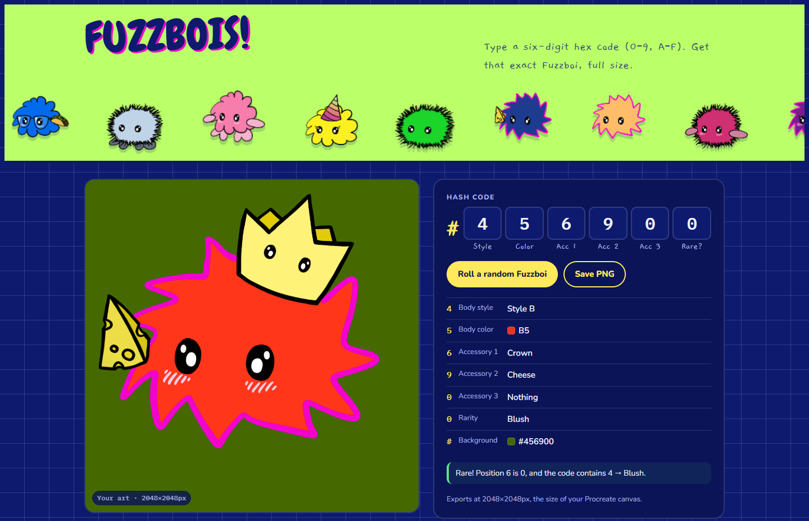

# Fuzzboi Factory

*By Astra.* Fuzzy little characters built from a six-digit hash code: type any code (like `C0FFEE`) and save that exact
Fuzzboi as a PNG.

## The Forge

Every code picks a body style, a body color, up to three accessories and sometimes a rarity, and the same six digits
become the background color.

<a href="https://findastra.github.io/fuzzboi-factory/"></a>

**[▶ Make your Fuzzboi](https://findastra.github.io/fuzzboi-factory/)**

**Needs:** a browser. Its pet app is Fuzzboi Friend (private repo).

## What's in here

| Folder | What it is |
|---|---|
| `site/` | **Fuzzboi Forge**, [live here](https://findastra.github.io/fuzzboi-factory/). Type a code, get that exact Fuzzboi at 2048×2048 and save it as a PNG. `site/fuzzboi.js` holds the rules and drawing (Fuzzboi Friend loads the same file); `site/layers/` holds the 32 cut-out layers it stacks. |
| `art/procreate-export/` | The original Procreate "PNG Files" export (`Fuzzbois-1.png` … `Fuzzbois-33.png`), navy background baked in. 33 is the design notes page. |
| `art/banner/` | The Fuzzbois parade banner and the nine sprites cut from it. |
| `3d/` | The 3D Fuzzboi #456800 (red, crown, taco, blush): Blender source, FBX, Unity package, previews, and the script that builds it. |
| `tools/key_layers.py` | Removes the baked-in navy background from a Procreate export and names each layer by its trait. |
| `legacy/2021/` | `Ownable.sol` from the 2021 NFT attempt (an OpenZeppelin contract, previously committed under the file name "SPDX License Identifier: MIT"). |

## The code

**The rules are Astra's handwritten design notes, [`art/procreate-export/Fuzzbois-33.png`](art/procreate-export/Fuzzbois-33.png).** When anything here disagrees with that sheet, the sheet wins.

Positions are read left to right. **For now, letters A–F count as 0–5** (A=0, B=1, C=2, D=3, E=4, F=5) so every hex code makes a Fuzzboi; the background still uses the exact code. This is a temporary rule (2026-10-09) until letters get their own traits.

| Position | Trait | Rule |
|---|---|---|
| 1 | Body style | 0–2 → **A** (fuzzy black outline) · 3–5 → **B** (pink spiky outline) · 6–9 → **C** (cloud) |
| 2 | Body color | 1/6 → 1 · 2/7 → 2 · 3/8 → 3 · 4/9 → 4 · 5/0 → 5 |
| 3 | Accessory 1 | see list |
| 4 | Accessory 2 | see list |
| 5 | Accessory 3 | see list · no Fuzzboi wears two hats |
| 6 | Rare flag | 0 = rare |
| all six | Background | the code itself, as a hex color |

**Accessories** (from the design notes): 0 nothing · 1 cowboy hat · 2 joint · 3 birthday hat · 4 butterfly · 5 flower · 6 crown · 7 glasses · 8 taco · 9 cheese. Hats are 1, 3 and 6. The Procreate layers were numbered with cheese and taco the other way round, and the layer files keep those names (`acc8.png` is the cheese, `acc9.png` the taco); `site/fuzzboi.js` maps 8 → taco and 9 → cheese.


**Rarities:** 1 hands · 2 feet · 3 eyelashes · 4 blush. From the notes: if position 6 is 0 the Fuzzboi is rare, and it gets every rarity whose number appears in the code ("if whole hash # contains 1, 2, and/or 3 get all!", with blush = 4 added).

Layer order, bottom to top: feet, body fill, body outline, glasses, eyes, blush, eyelashes, hands, taco, cheese, crown, flower, birthday hat, joint, cowboy hat, butterfly.

## Exporting layers from Procreate

1. Open the Layers panel and **uncheck "Background color"** so the layers come out transparent.
2. Actions (wrench) → Share → Share Layers → **PNG Files**.
3. Files arrive as `Fuzzbois-1.png` … numbered from the bottom of the stack; the generator maps those numbers to traits. If the background was left on, run `python3 tools/key_layers.py` from a folder containing `x/fuzzbois/` to cut it out.

## 3D

`3d/build_fuzzboi.py` builds the model with Blender's Python module (`pip install bpy`) and checks that the crown and taco don't intersect the body, nudging them out if they do. `python3 3d/build_fuzzboi.py render` also renders previews. Import `Fuzzboi_456800.unitypackage` into Unity via Assets → Import Package → Custom Package. The pink rim is an inverted hull, so it needs a back-face-culled shader (Unity Standard works; Poiyomi or lilToon look better in VRChat). It's about 170k triangles: fine as a world prop, too heavy for an avatar.

## Desktop original-body variants
Run node desktop-recipes-20261011.cjs (with astras-pet-os next to this repo) to write the 858 valid combinations into the hub across original styles A, B and C using the shared Forge decoder and original layer stack. Astra's PetOS selects a random recipe at launch, composites the original layers transparently, and starts with a jagged Style B pet. Triple-click cycles B, C and A with a fresh random combination; double-click opens the app. The desktop renders original layers at its display resolution for quick changes. Desktop drawing uses a black outline. No generated replacement body or copied trait rules. Prepared by OpenAI Codex (GPT-6), 2026-10-11.

## Quirks

1. **Letters A–F.** The notes use a hex code as the background color, but give no trait to letters. Until Astra adds them, the pages count a letter as its value minus 10 (A=0 … F=5). That stopgap was chosen by Claude on 2026-10-09, not by Astra; it's in `site/fuzzboi.js`, and the page says so whenever a code has a letter.
2. **Position 6 is 0 but no 1–4 appears.** The notes say a 0 there means rare, but not which rarity it gets if the code has no 1, 2, 3 or 4. The pages show no rarity and say why.
3. A side effect of the rules as written: a cloud body (position 1 is 6–9) can only get hands from a 1 in an accessory slot, so a cloud with hands always wears the cowboy hat.

## Developer Notes

1. **Run the generator on your PC:** browsers won't export a canvas built from `file://` images, so serve the folder:

   ```sh
   cd site
   python3 -m http.server 8000
   # open http://localhost:8000/#456900
   ```

2. **The layers** load from the hub automatically: Astra's 32 layers live in
   [findastra/astras-pet-os](https://github.com/findastra/astras-pet-os) `desktop-art/fuzzboi-friend/layers/` (one art
   source), shared with Fuzzboi Friend and the desktop pet. Offline it reads the hub folder next to this repo.
3. **The website:** GitHub Pages serves the repo root from `main`; `index.html` there sends visitors on to `site/`, and
   a code in the address (`#456900`) opens that Fuzzboi.
4. **Rules:** [AGENTS.md](AGENTS.md).

## Credits

1. The Fuzzbois, their layers and the design notes are Astra's own, drawn in Procreate (first committed in 2021).
2. The Forge, the code rules and the 3D Fuzzboi: built with Claude Opus 5.5, from 2026-10-04. The desktop variants:
   OpenAI Codex (GPT-6), 2026-10-11.
3. `legacy/2021/Ownable.sol` is an OpenZeppelin contract.
4. The picture above is a screenshot of the live Forge, 2026-10-29.
